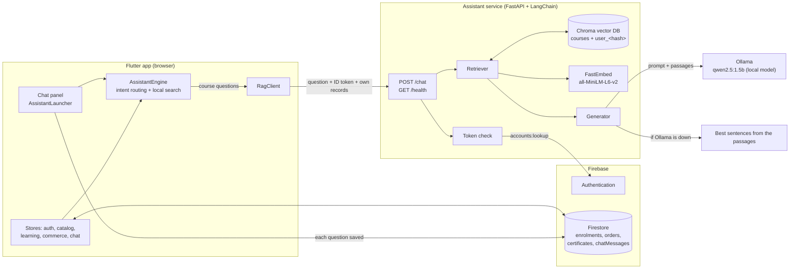

# The assistant: how it works and how it is built

The assistant is the "Ask" button at the bottom right of every page. It answers questions about a learner's own progress, payments, orders and certificates, suggests courses they can add, and answers questions about what is taught in the courses.

Answers are drawn as charts, progress bars and course cards where that is clearer than text. Questions are saved per user so "Your recent questions" follows them between visits.

## Architecture



Two paths answer a question:

| Path | Handles | Where it runs | Data it uses |
|---|---|---|---|
| Local engine | progress, payments, orders, certificates, prices, "which courses can I add", buying a course | in the browser | the learner's live Firestore records, already loaded by the app |
| Retrieval service (RAG) | questions about course content ("explain the ninety second pause") | the assistant service | the vector database of course material, plus the learner's own records |

If the service is not reachable, course questions fall back to a keyword search (BM25) that runs inside the app, so the chat never breaks.

## What happens when someone asks a question

1. **The question is typed** into the chat panel (or a suggestion is tapped).
2. **The local engine reads it.** It picks an intent from the words used (progress, payment, orders, certificate, price, recommend, or a content question) and notices if a course is named.
3. **Personal questions are answered right there**, from the records the app already holds, and drawn as bars, a payment chart or course cards. Nothing about them is sent to the assistant service.
4. **Content questions go to the service.** The app sends the question, the learner's Firebase ID token and a small snapshot of their own records.
5. **The service checks the token** with Firebase's own lookup endpoint. A missing or invalid token makes the caller a guest: they get course answers only and the snapshot is ignored.
6. **The snapshot is indexed.** Progress, orders, certificates and pathway are turned into short passages and stored in that learner's own Chroma collection (`user_<hash of uid>`). It is only re-indexed when the records change.
7. **Retrieval.** The question is turned into a vector with the local embedding model. The nearest passages are fetched from the shared `courses` collection and from the learner's collection. A learner's own records get a small score boost, and anything under the relevance threshold is dropped. That is why an off-topic question gets "I could not find that" instead of a made-up answer.
8. **Generation.** A LangChain chain builds a prompt from the question and the retrieved passages and sends it to the language model. The prompt tells the model to use only that context, to name the lesson or record it used, and to say so when the context does not contain the answer.
9. **The reply** comes back with the answer text, which model wrote it, and the sources used. The app shows the answer with source chips that open the course or record.
10. **The question is saved** to Firestore (`chatMessages`) for the recent-questions list. Answers are not saved; they are worked out again from current records.

## Which model writes the answer

The service picks the first option that is available, per question:

1. **Ollama** (default `qwen2.5:1.5b`), a model that runs on the same computer. The service checks `http://localhost:11434` and whether the model is installed, and re-checks every 20 seconds, so Ollama can be started or stopped while the service runs.
2. **Claude**, only if `ANTHROPIC_API_KEY` is set.
3. **Extractive**: no model. The answer is the sentences of the best passages that share the most words with the question.

If a model fails or returns nothing, that question falls back to the extractive answer. The label above each answer says which one produced it: "Answered by qwen2.5:1.5b on Ollama", "AI answer", or "From the course material".

## Where each part lives

| Part | File |
|---|---|
| Chat button and panel | `lib/widgets/assistant/assistant_launcher.dart` |
| Charts, bars, cards, answer view | `lib/widgets/assistant/reply_blocks.dart` |
| Intent routing and reply types | `lib/assistant/assistant_engine.dart` |
| In-app keyword search (fallback) | `lib/assistant/knowledge.dart` |
| Service client and records snapshot | `lib/assistant/rag_client.dart` |
| Conversation and saved questions | `lib/state/chat_store.dart` |
| Security rule for saved questions | `firestore.rules` (`chatMessages`) |
| API | `server/app/main.py` |
| Retrieval chain, vector stores, model choice | `server/app/rag.py` |
| Settings | `server/app/config.py` |
| Token check | `server/app/auth.py` |
| Course passages (source for the index) | `tools/content/*.py`, `assets/data/course_knowledge.json` |

## Privacy

- Saved questions can be read and deleted only by the person who asked (Firestore rule on `chatMessages`).
- Each learner's records live in their own vector collection, and only a verified token unlocks it. Guests never reach personal records.
- With Ollama, questions and records are processed on the computer running the service and are not sent to an outside AI provider. With a Claude key set, the retrieved passages and the question are sent to Anthropic.
- The records snapshot comes from the app, so a learner could send false records about themselves, but that only changes their own answers.
- The service allows 30 questions a minute per person.

## Running it

```bash
# 1. Ollama (once)
ollama pull qwen2.5:1.5b

# 2. The service
cd server
python -m venv .venv
.venv/Scripts/python -m pip install -r requirements.txt
.venv/Scripts/python ingest.py                                  # builds the course index
.venv/Scripts/python -m uvicorn app.main:app --port 8710

# 3. The app (served on localhost:8080) calls http://localhost:8710 by default
```

Check it: `GET http://localhost:8710/health` reports the model in use (`mode`), the embedding model and the number of indexed passages. `python server/try_chat.py` asks sample questions as the demo learner.

Settings (environment variables): `OLLAMA_MODEL`, `OLLAMA_URL`, `USE_OLLAMA=off`, `ANTHROPIC_API_KEY`, `ANTHROPIC_MODEL`, `MIN_RELEVANCE`, `ALLOWED_ORIGINS`. The app's service address is a build setting: `--dart-define=RAG_URL=...` (empty turns the service off).

After the course content changes: `python -m tools.content.export_knowledge` from the repository root, then `python server/ingest.py`.

## Limits

- The live GitHub Pages site cannot reach a service on your own computer, so there the chat uses the in-app keyword search. To use the full assistant on the live site the service must be hosted (the `server/Dockerfile` is ready) and the site published with `RAG_URL` set.
- A 1.5 billion parameter model on a CPU answers in a few seconds to half a minute and can still word things loosely. Retrieval keeps it on the course material, and the sources are shown so answers can be checked. A larger Ollama model (set `OLLAMA_MODEL`) gives better wording at the cost of speed.
- The embedding model is small. It ranks personal records and lessons well but can occasionally rank a related record above the exact one.
