# MT Alchemy: entity relationship diagram (final)

Cloud Firestore stores these entities as top-level collections. Course modules (lessons) and their quiz questions are embedded in the course document, so the course player loads everything in one read. Order items are embedded in the order for the same reason. Both still appear below as their own entities.

```mermaid
erDiagram
    USERS ||--o| ORGANIZATIONS : "owns (employer)"
    ORGANIZATIONS ||--o{ EMPLOYEES : employs
    ORGANIZATIONS ||--o{ ASSIGNMENTS : makes
    EMPLOYEES ||--o{ ASSIGNMENTS : receives
    COURSES ||--o{ MODULES : contains
    MODULES ||--o{ QUIZ_QUESTIONS : "quiz lessons have"
    COURSES ||--o{ ASSIGNMENTS : "assigned as"
    USERS ||--o{ ENROLMENTS : has
    COURSES ||--o{ ENROLMENTS : "taken via"
    ENROLMENTS ||--o| CERTIFICATES : "earns on completion"
    USERS ||--o{ ASSESSMENTS : "takes (EQ)"
    PRODUCT_CATEGORIES ||--o{ PRODUCTS : groups
    USERS ||--|| CARTS : has
    USERS ||--o{ ORDERS : places
    ORDERS ||--|{ ORDER_ITEMS : contains
    ORDERS ||--|| PAYMENTS : "paid by"
    ORDERS ||--o| SHIPPING : "ships with (physical)"
    ORDERS ||--o{ DOWNLOADS : "unlocks (digital)"
    ORDERS ||--o{ ENROLMENTS : "unlocks (course)"
    USERS ||--o{ REVIEWS : writes
    COURSES ||--o{ REVIEWS : receives
    PRODUCTS ||--o{ REVIEWS : receives
    USERS ||--o{ NOTIFICATIONS : receives

    USERS {
        string uid PK
        string name
        string email
        string role "individual|employer|trainer|superAdmin"
        string orgId FK
        string gender
        string country
        array hobbies
        bool disabled
        timestamp createdAt
    }
    ORGANIZATIONS {
        string id PK
        string name
        string sector
        string size
        string ownerId FK
        map seats "courseId -> unassigned seats"
    }
    EMPLOYEES {
        string id PK
        string orgId FK
        string name
        string email
        string team
    }
    COURSES {
        string id PK
        string title
        string serviceSlug
        string level
        number price
        string summary
        array outcomes
        string trainer
        bool published
    }
    MODULES {
        string id PK
        string title
        string type "text|video|pdf|quiz"
        number minutes
        string body
        string mediaUrl
    }
    QUIZ_QUESTIONS {
        string prompt
        array options
        number answer
    }
    ASSIGNMENTS {
        string id PK "orgId_employeeId_courseId"
        string orgId FK
        string employeeId FK
        string employeeEmail
        string courseId FK
        timestamp assignedAt
    }
    ENROLMENTS {
        string id PK "uid_courseId"
        string userId FK
        string courseId FK
        string orderId FK
        string assignmentId FK
        string orgId FK
        array completedModuleIds
        map quizScores
        number progress
        string status "active|complete"
    }
    CERTIFICATES {
        string code PK
        string userId FK
        string courseId FK
        string userName
        string courseTitle
        timestamp issuedAt
    }
    ASSESSMENTS {
        string id PK
        string userId FK
        string type
        map scores
    }
    PRODUCT_CATEGORIES {
        string id PK
        string label
    }
    PRODUCTS {
        string id PK
        string name
        string category FK
        string type "digital|physical"
        number price
        number stock
        string fileUrl
    }
    CARTS {
        string userId PK
        array items
    }
    ORDERS {
        string number PK "MTA-12345"
        string userId FK
        string orgId FK
        string status
        number subtotal
        number shipping
        number total
    }
    ORDER_ITEMS {
        string id FK "course or product id"
        string kind "course|seats|digital|physical"
        number price
        number quantity
    }
    PAYMENTS {
        string id PK
        string orderId FK
        string userId FK
        number amount
        string last4
        string status
    }
    SHIPPING {
        string orderId PK
        string userId FK
        map address
        string status "processing|shipped|delivered"
        string tracking
        array history
    }
    DOWNLOADS {
        string id PK "uid_productId"
        string userId FK
        string productId FK
        string url
        number downloadCount
    }
    REVIEWS {
        string id PK
        string targetId FK "course or product"
        string userId FK
        number rating
        string comment
    }
    IMPACT_STORIES {
        string id PK
        string quote
        string name
        string role
        string metric
    }
    ARTICLES {
        string slug PK
        string title
        string category
        array body
    }
    ENQUIRIES {
        string id PK
        string organisation
        string email
        string interest
        string status "new|in-discussion|proposal|won|closed"
        string proposal
    }
    NOTIFICATIONS {
        string id PK
        string userId FK
        string title
        bool read
    }
```

## Access summary (from `firestore.rules`)

| Collection | Guest | Individual | Employer | Trainer | Super admin |
|---|---|---|---|---|---|
| courses | read published | read published | read published | full CRUD | full CRUD |
| products, articles, impactStories, reviews | read | read; write own reviews | read | read; articles CRUD | full CRUD |
| users | none | own profile (no role change) | own profile | read all | full CRUD |
| organizations, employees, assignments | none | own assignments | own organisation only | read | full |
| enrolments | none | own (needs a paid order or an assignment) | own organisation's | read | full |
| orders, payments, shipping, downloads | none | own | own organisation's orders | none | full, and advances shipping |
| enquiries | create only | create only | create only | none | read and update |
